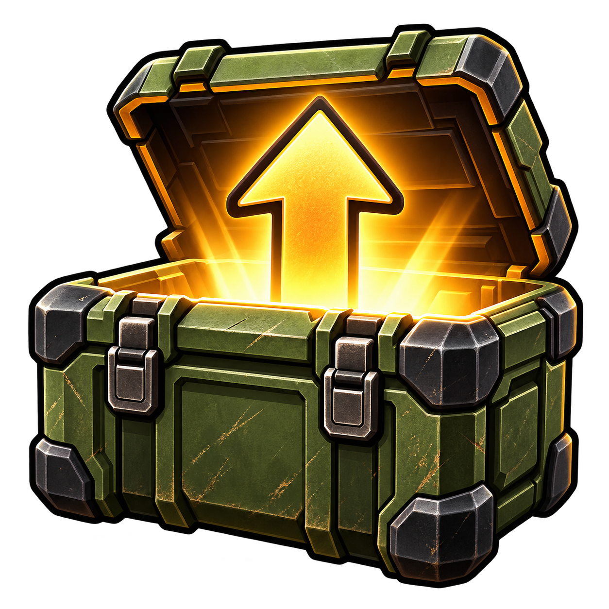

<div align="center">



# Beast Pick — Dying Light 2 & The Beast Auto Loot

**Auto loot and auto pickup for Dying Light 2 and Dying Light: The Beast on Windows**

[简体中文](README.md) · English

[](#requirements)
[](https://github.com/hyhacct/beast-pick/actions/workflows/ci.yml)
[](https://github.com/hyhacct/beast-pick/releases/latest)
[](LICENSE)

[Download](https://github.com/hyhacct/beast-pick/releases/latest) · [Quick start](#quick-start) · [Supported builds](#supported-game-builds) · [Limitations](#validation-and-limitations)

</div>

**Beast Pick (BP)** is an automatic loot and pickup tool for supported Windows builds of **Dying Light 2** and **Dying Light: The Beast**. It finds loaded objects near the local player and can loot corpses, ordinary containers and loose items. The UI and resolved item names are currently in Chinese.

> **Status:** Local samples of corpse, ordinary-container and loose-item pickup have been tested in both games. An exact Dying Light 2 weapon exclusion was also tested. Automatic cabinet opening is off by default; the separate lock option is experimental. The complete Dying Light 2 automatic cabinet flow and special collectible pickup still need live testing. Game crashes have occurred, the cause is not fully established, and long-term and co-op behavior remain unverified.

## Features

- Choose Dying Light 2, The Beast, or automatic detection. The connected game is shown in the window title and status.
- Toggle corpse looting, ordinary-container looting and loose-item pickup independently; configure a **1–500 m** radius (default 8 m).
- Turn weapon pickup off globally or exclude specific weapons and throwables by name or internal ID. Each game keeps its own exclusion list; selecting a displayed name covers its listed variants.
- Optionally open recognized cabinets. Locked cabinets require a separate experimental opt-in; targets must be loaded and simulated.
- Press **F6** to start / pause and **F8** to stop. Check and install GitHub Release updates after confirmation.

The current UI does not expose the old DIY weapon page or rapid-melee controls. Opening a cabinet and collecting its contents are separate operations: loose-item pickup must also be enabled.

## Supported game builds

| Game | Supported build | Profile |
| --- | --- | --- |
| Dying Light: The Beast | ph-ft patch08, 2026-10-30 / 6550878; Steam BuildID `26402545` | [current.json](beast_pick/profiles/current.json) |
| Dying Light 2 | locally tested `1.30.2.0na` | [dl2.json](beast_pick/profiles/dl2.json) |

BP validates the loaded engine and game DLL SHA-256 hashes and image sizes. A matching version label alone is not sufficient; other game builds may need a new profile.

## Quick start

### Requirements

Windows x64 and a running, supported game with a save loaded. The packaged release does not require Python or Node.js.

### Download and run

1. Download `BP-vX.Y.Z-windows-x64.zip` from [GitHub Releases](https://github.com/hyhacct/beast-pick/releases/latest), extract it and run `BP.exe`.
2. Choose the game in the toolbar or use automatic detection. Select a game explicitly if both are running.
3. Click **连接游戏** (Connect), configure radius and target types, then return to the game.
4. Press **F6** to start / pause or **F8** to stop. BP starts stopped on each launch.

### Main controls

| Chinese label | Meaning |
| --- | --- |
| 自动搜刮尸体 | Loot corpses |
| 自动搜刮普通容器 | Loot ordinary containers; required for cabinet opening |
| 自动拾取散落物品 | Pick up loose items, including generated cabinet items |
| 拾取武器 | Allow weapon-category items globally |
| 排除指定武器 / 投掷物 | Search and exclude individual weapon / throwable names and their listed variants |
| 自动开启箱柜 | Opt in to opening supported cabinets |
| 强制开启锁箱柜（试验） | Separate experimental opt-in for recognized locked cabinets |

For example, searching for `草叉` in The Beast's list selects the three listed pitchfork variants. Improvised thrown items can have a throwable category, so use the individual exclusion list for them. When exclusions are active, unreadable identities in relevant categories and opaque item bundles are skipped rather than silently bypassing the rule.

## Validation and limitations

- Dying Light 2 samples include corpses, ordinary containers, dropped weapons and an exact exclusion of `技工锤头`: the excluded hammer remained while another item was picked up.
- One direct probe opened a medium locked cabinet. BP subsequently picked up nearby items, but their attribution to that cabinet was not established. The complete automatic cabinet flow and special collectible pickup remain untested in a live session.
- The Beast has historical local samples for corpses, ordinary containers, loose items and weapon exclusion. Its individual pitchfork exclusion has an offline policy test, not a new live test.
- The radius uses straight-line distance and may cross walls or floors; unloaded or inactive objects cannot necessarily be processed. Inventory-full, death / cutscenes, save transitions, co-op ownership and long-term behavior are not fully validated.
- Crashes have occurred; their cause is not fully confirmed. CI does not run the game and does not replace live testing. See [implementation history](docs/implementation.md).

## Run from source

```powershell
git clone https://github.com/hyhacct/beast-pick.git
cd beast-pick
py -3.12 -m venv .venv
.\.venv\Scripts\python.exe -m pip install -e ".[dev]"
.\.venv\Scripts\python.exe -m beast_pick
```

For checks, packaging and release workflow, see [CONTRIBUTING.md](CONTRIBUTING.md). Settings and logs are stored beside the packaged EXE, or at the repository root when running from source.

## Feedback and license

Report issues with the game name, build, target type, reproduction steps and relevant logs. Project code is available under the [MIT License](LICENSE). This is an unofficial tool.